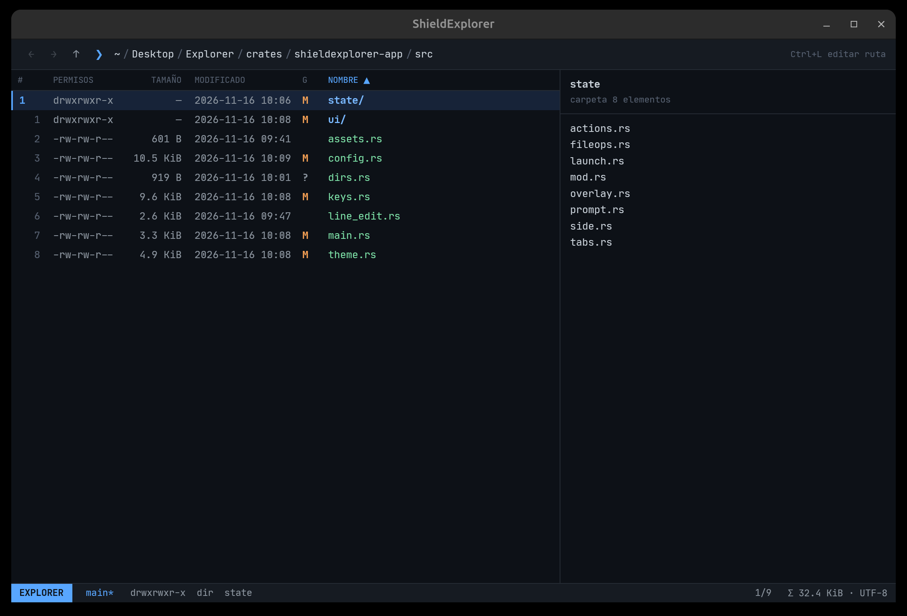

# ShieldExplorer

A file explorer for Linux written in Rust with [GPUI](https://www.gpui.rs/), the GPU-accelerated
UI framework behind the [Zed](https://zed.dev) editor. It is built for **developers and technical
users** who want to move fast **without touching the mouse**. It has two keyboard modes you can
switch between at any time: a **standard explorer mode** and a **vim mode**. The look is
terminal-like, with the information that matters in plain sight (permissions, exact size, date, git
status).

> **Vibe-coded project.** I'm building this with the help of AI, for fun, to have a file explorer
> made to my own taste. A human decides what gets built and tests it; the code is written by an AI.
> Keep that in mind if you read the code or plan to use it: this is a personal project that is still
> evolving, not a finished product.



## Status

Early but already usable day to day: browse, preview, search, open files, and copy, move, delete,
rename and create them. It does **not** yet have a dual pane, a side tree, or browsable archives
(see the [roadmap](#roadmap)).

The logic (`shieldexplorer-core`, 69 tests) and the configuration parser are covered by automated
tests. The UI is tested by hand: I could check by running it that the listing, preview, git marks and
automatic refresh work, but most keybindings and clicks have no automated tests yet, so expect rough
edges.

## What it does

- **Two keyboard modes**, switched with `Ctrl+Shift+M` or by clicking the mode label in the status
  bar. The choice is remembered. See [Keybindings](#keybindings).
- **Detailed listing** in the style of `ls -l`: permissions, size, date and name. Folders come
  first and end in `/`; symbolic links end in `@` and show where they point (`→ target`).
- **Preview pane** on the right that follows the selection: the contents of a folder, the first
  lines of a text file, an image, or the size of a binary. `Tab` shows or hides it.
- **Git status**: a mark per file (`M` `A` `R` `D` `U` `?`), folders show the most serious mark of
  what they contain, and the branch (with `*` if dirty, and `↑`/`↓` ahead and behind) sits in the
  status bar.
- **Live updates**: the open folder refreshes by itself when files are created, deleted or renamed
  elsewhere, keeping your cursor and selection.
- **File operations**: copy, cut, paste, delete to the trash, rename, create files and folders, and
  **undo**, with multi-select (visual mode or marks). Nothing is overwritten, and deleted files go
  to the freedesktop trash so they can be restored.
- **Open things**: `Enter` opens a file with the system default (`xdg-open`), another key opens it in
  `$EDITOR` (inside a terminal if the editor needs one), and another opens a terminal in the folder.
- **Fuzzy finder** (`Ctrl+P`): jump to any file in the project, respecting `.gitignore`. A second
  finder (`Ctrl+O`) jumps to frequently visited folders, like zoxide.
- **Command line** (`:`) with `cd`, `mkdir`, `rename`, `sort`, `z`, `yank`... and `:!command` to run
  a shell command in the folder, with live, cancelable output.
- **Marks**: save a folder under a letter and jump back to it.
- **Disks**: see your mounted drives with used and free space, and jump into any of them. The trash
  is one key away.
- **Real folder sizes**: computed in the background, in parallel, on demand.
- **Search and navigation**: `/` with incremental matching in vim mode, type-to-jump in explorer
  mode, counts like `5j`, sorting by name, size or date, and show/hide hidden files.
- **Tabs**.
- **Fast**: virtualized list, all disk work off the UI thread, stale loads discarded, and the fuzzy
  search spread over all CPU cores.
- **Light and dark theme** that follows the system. Colors, columns and keybindings can be changed in
  a [config file](#configuration).

## Keybindings

Switch mode with `Ctrl+Shift+M`. The default is **explorer** mode. Quit with `Ctrl+Q`.

### Vim mode

| Key                         | Action                                                               |
| --------------------------- | -------------------------------------------------------------------- |
| `j` / `k` (or `↓` / `↑`)    | Move down / up. A number first repeats it: `5j`, `12k`               |
| `l` / `→` / `Enter`         | Open the folder, or open the file with the default program           |
| `h` / `←` / `Backspace`     | Go to the parent folder (the cursor lands on the one you left)       |
| `gg` / `G`                  | First / last row. With a number, go to that row: `5gg`, `5G`         |
| `Ctrl+D` / `Ctrl+U`         | Half a page down / up                                                |
| `/`, `n`, `N`               | Search by name as you type; next / previous match (`3n` repeats)     |
| `v`, `Space`                | Visual selection; mark or unmark the current row                     |
| `yy`, `dd`, `p`             | Copy, cut, paste                                                     |
| `x`                         | Delete to the trash (undo with `u`)                                  |
| `r`, `a`, `A`               | Rename, new file, new folder                                         |
| `u`                         | Undo the last operation                                              |
| `yp`, `yn`, `yr`            | Copy to the clipboard the absolute path, the name, or the relative path |
| `e`, `o`, `t`               | Open in `$EDITOR`, open with the default program, open a terminal here |
| `:`                         | Command line                                                         |
| `m` + letter, `'` + letter  | Save the folder under that letter, jump to it                        |
| `s`                         | Compute the real size of every folder                                |
| `gd`, `gt`, `gh`, `gz`      | Disks, trash folder, home, frequent folders                          |
| `.`                         | Show or hide hidden files                                            |
| `i`                         | Edit the path                                                        |
| `[` / `]`                   | Previous / next tab                                                  |
| `Ctrl+C`                    | Cancel the running `:!` command                                      |
| `Esc`                       | Clear a pending number, a selection, a message, or the output panel  |

Searching is "smartcase", as in vim: lowercase matches any case, and a capital letter makes it
case-sensitive.

### Explorer mode

| Key                    | Action                                                              |
| ---------------------- | ------------------------------------------------------------------- |
| `↓` / `↑`              | Move down / up                                                      |
| `Enter`                | Open the folder, or open the file with the default program          |
| `Backspace` / `Alt+↑`  | Go to the parent folder                                             |
| *typing letters*       | Jump to the entry whose name starts with what you type              |
| `Ctrl+C` / `Ctrl+X` / `Ctrl+V` | Copy, cut, paste                                            |
| `Delete`               | Delete to the trash                                                 |
| `F2`, `Ctrl+N`, `Ctrl+Shift+N` | Rename, new file, new folder                                |
| `Ctrl+Z`               | Undo the last operation                                             |
| `Ctrl+A`, `Insert`, `Shift+↑/↓` | Select all, mark the current row, extend the selection     |
| `Ctrl+Shift+C`         | Copy the absolute path to the clipboard                             |
| `Ctrl+E`, `F12`        | Open in `$EDITOR`, open a terminal here                             |
| `Ctrl+D`               | Disks                                                               |
| `Ctrl+Shift+P`         | Command line                                                        |
| `Ctrl+Shift+S`         | Compute the real size of every folder                               |
| `Ctrl+H`               | Show or hide hidden files                                           |
| `Ctrl+L` / `F4`        | Edit the path                                                       |

### In both modes

| Key                          | Action                                         |
| ---------------------------- | ---------------------------------------------- |
| `Home` / `End`, `PageUp` / `PageDown` | First / last row, a page up / down    |
| `Alt+←` / `Alt+→`            | Back / forward in history                      |
| `Tab`                        | Show or hide the preview pane                  |
| `Ctrl+P`                     | Fuzzy finder for files in the project          |
| `Ctrl+O`                     | Fuzzy finder for frequently visited folders    |
| `Ctrl+Shift+T`, `Ctrl+W`     | New tab, close tab                             |
| `Ctrl+Tab`, `Ctrl+Shift+Tab` | Next / previous tab                            |
| `F5`                         | Reload the folder                              |
| `Esc`                        | Dismiss an error, a selection or a message     |
| `Ctrl+Shift+M`               | Switch between vim and explorer mode           |
| `Ctrl+Q`                     | Quit                                           |

In the path field, the search, the command line and the finders: `Enter` confirms and `Esc` cancels.
Move with `←` `→` `Home` `End`, delete with `Backspace` and `Delete`, and paste with `Ctrl+V`. In the
finders, `↑`/`↓` (or `Ctrl+P`/`Ctrl+N`) choose a result.

### Command line

`:cd [path]`, `:mkdir name`, `:touch name`, `:rename name`, `:rm` (to the trash), `:trash` (open the
trash folder), `:open`, `:edit`, `:term`, `:hidden`, `:sort name|size|date [r]`, `:mode
vim|explorer`, `:mark a`, `:jump a`, `:z query`, `:yank path|name|rel`, `:du`, `:undo`, `:reload`,
`:disks`, `:tabnew`, `:tabclose`, `:preview`, `:q`, and `:!command`, where `%s` becomes the selected
name, already quoted.

### Mouse (optional)

Click selects, double-click opens, clicking a column header sorts, clicking a path segment jumps to
that level, the wheel scrolls, the tabs are clickable, and clicking the mode label switches the mode.

## Configuration

`~/.config/shieldexplorer/config` (or `$XDG_CONFIG_HOME/shieldexplorer/config`) is a plain text file
of `key = value` lines. Everything is optional, and lines it cannot understand are ignored with a
warning on stderr.

```text
mode = vim                       # vim | explorer (also saved when you switch)
show_hidden = true
preview = true
theme = system                   # system | light | dark
columns = perms, modified, git   # optional columns; size and name are always shown
bind vim ctrl-x = cut            # bind <vim|explorer|all> <keys> = <action>
bind all g x = disks             # several keys in a row are allowed
color dark accent = #ff8800      # color <dark|light> <name> = #rrggbb
```

Actions for `bind`: `move_down` `move_up` `page_down` `page_up` `half_down` `half_up` `first` `last`
`open` `open_default` `edit` `terminal` `parent` `back` `forward` `home` `trash_folder` `edit_path`
`hidden` `reload` `mode` `preview` `sizes` `search` `search_next` `search_prev` `command` `mark`
`jump` `copy` `cut` `paste` `delete` `rename` `new_file` `new_dir` `undo` `visual` `toggle_mark`
`select_all` `yank_path` `yank_name` `yank_rel` `finder` `folders` `disks` `cancel_command` `tab_new`
`tab_close` `tab_next` `tab_prev` `quit`. Color names: `bg` `bar` `border` `text` `muted` `faint`
`cursor` `marked` `accent` `on_accent` `danger` `dir` `image` `code` `doc` `media` `archive`.

Marks and visited folders are remembered in `~/.local/state/shieldexplorer/memory`.

## Safety and robustness

- `unsafe_code` is **forbidden** in the project's own code (dependencies do use it), and there is
  no `unwrap`, `expect` or `panic!` in it. Errors are typed.
- It only starts other programs when you ask: opening a file (`xdg-open`), the editor, a terminal, or
  a `:!` command. Programs are started without a shell, except `:!`, which is a shell command by
  design. For its own needs it calls `git`, `df` and `kill`.
- Nothing is overwritten: copies and moves pick a free name, and deleting sends to the trash, which
  can be undone. Names with `..` or absolute paths are refused when creating.
- File names are treated as what they are on Linux: bytes that need not be valid UTF-8.
- Symbolic links are shown as links and broken ones are flagged. Folder sizes do not follow links, and
  there is no recursive traversal in the listing, so there is no risk of loops.
- The trash is the one in your home directory. Deleting something on another drive copies it there
  first, which can be slow for big files.

## Building and running

You need:

- Rust with edition 2024 support (1.88 or later, for `let` chains). Tested with 1.92.
- Linux with Wayland or X11 and a graphics driver with Vulkan.
- Development headers for xkbcommon, Wayland, xcb and fontconfig. On the development machine
  (Ubuntu) these are installed: `libxkbcommon-dev`, `libxkbcommon-x11-dev`, `libwayland-dev`,
  `libxcb1-dev` and `libfontconfig-dev`. If the build fails on a missing library, start there.
- Optional, for the features that use them: `git`, `xdg-open`, and a terminal emulator.

```sh
# Open in the current folder, or in the one you pass
cargo run -p shieldexplorer-app
cargo run -p shieldexplorer-app -- ~/projects

# Optimized binary at target/release/shieldexplorer
cargo build --release
```

If you pass the path of a file, its folder opens with that file selected.

### Development

```sh
cargo fmt --all --check
cargo clippy --all-targets -- -D warnings
cargo test
```

The first build is slow because GPUI pulls in many dependencies.

## Layout

```
ShieldExplorer/
├── crates/
│   ├── shieldexplorer-core/   UI-free logic: folders, sorting, search, file operations, trash, git,
│   │                          disks, fuzzy finder, preview, command parser, shell runner
│   └── shieldexplorer-app/    GPUI app
│       └── src/ state/        listing, selection, operations, prompts, overlays, tabs (one file each)
│           └── ui/            path bar, list, preview, overlays, output panel, tabs, status bar
├── assets/fonts/              JetBrains Mono (OFL license)
└── docs/images/               screenshots
```

Dependencies point one way: `shieldexplorer-app` uses `shieldexplorer-core` and never the reverse,
so the logic can be tested without opening a window.

`gpui` is pinned to `=0.2.2` because its API is 0.x and changes between releases. `Cargo.lock`
starts from the one published with that version: with a recent `libc`, `xattr 0.2.3` does not
compile. Other dependencies: `ignore` (walk files respecting `.gitignore`), `notify` (live
refresh), `jiff` (dates), `thiserror`, `anyhow` and `futures`.

## Roadmap

No dates and no promises:

1. **Dual pane** and a **side tree**, in the style of ranger or mc.
2. **Browse archives** (zip, tar) as if they were folders.
3. **More vim:** `H`/`M`/`L`, `.` to repeat, and registers.
4. **Rename in bulk** and a bulk-edit buffer.
5. **Automated UI tests** with GPUI's test harness, and CI.
6. Release binaries (`.deb`, AppImage) and an English/Spanish interface (labels are Spanish today).

## Credits

- [GPUI](https://github.com/zed-industries/zed/tree/main/crates/gpui), by Zed Industries.
- [JetBrains Mono](https://github.com/JetBrains/JetBrainsMono), under the SIL OFL 1.1 license.

## License

To be decided.
